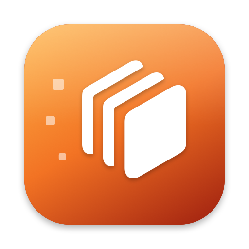
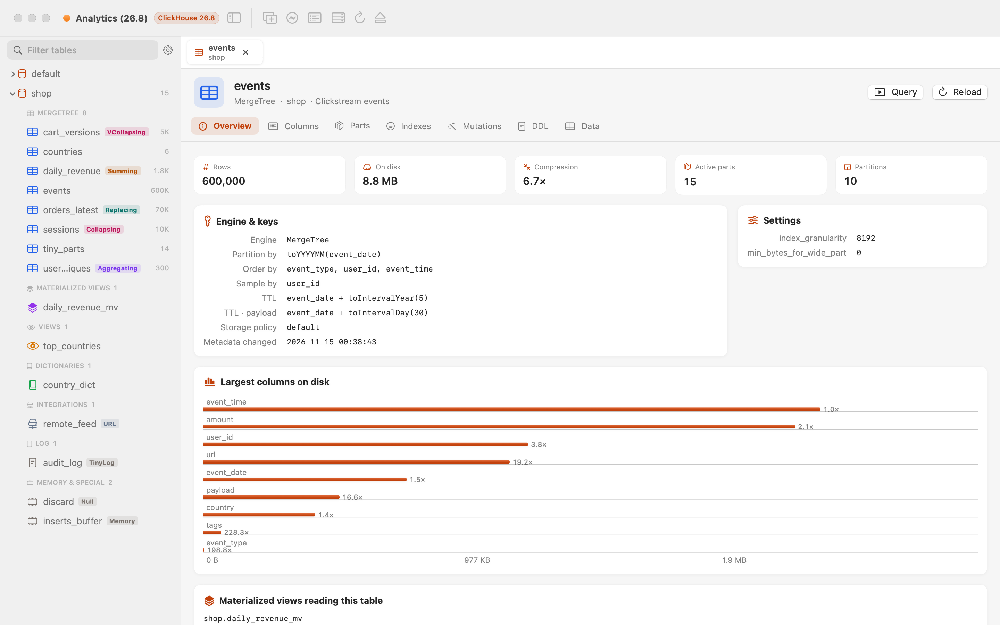
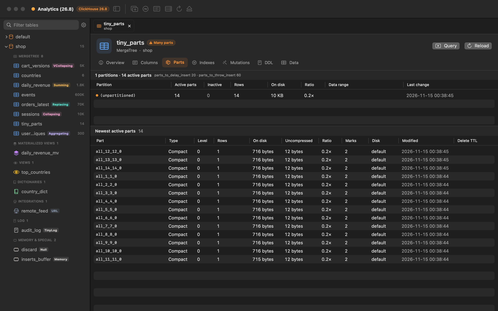
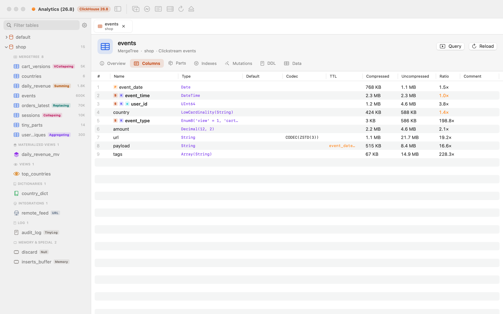
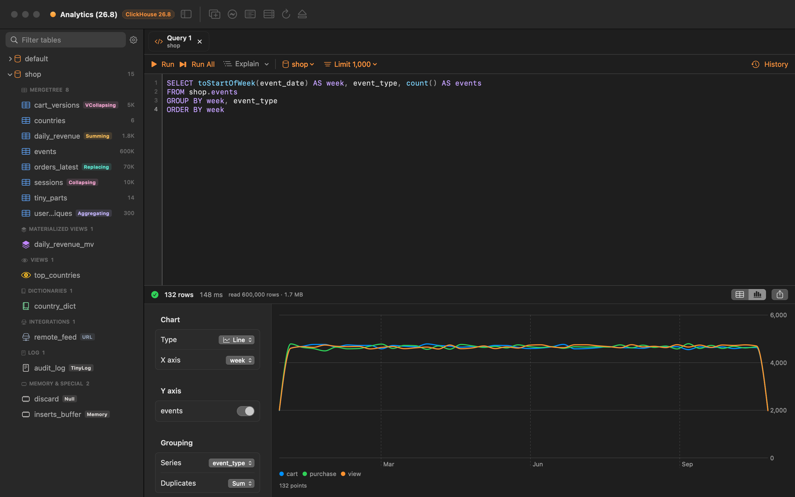
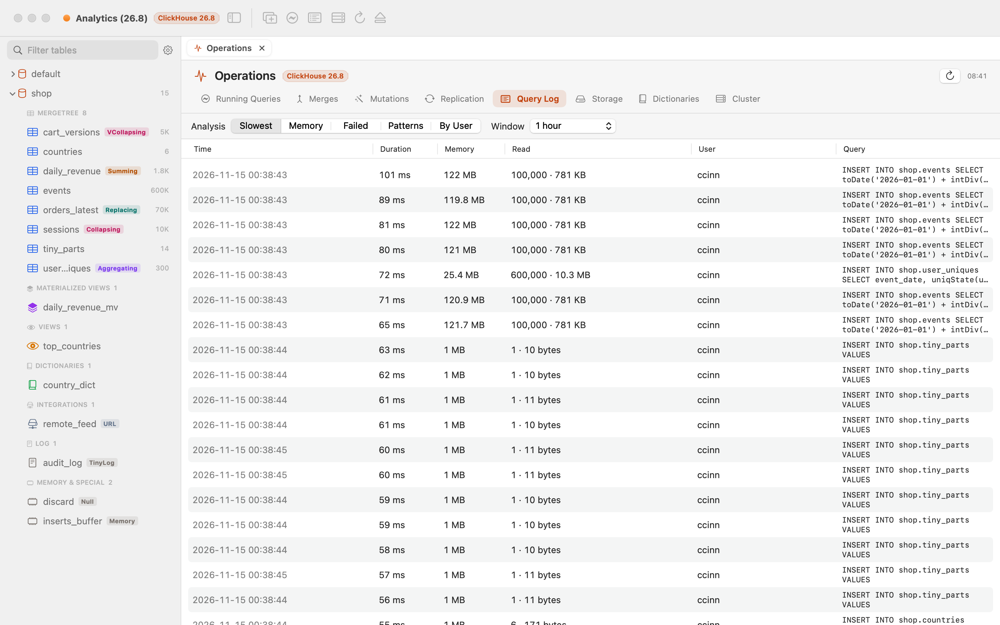
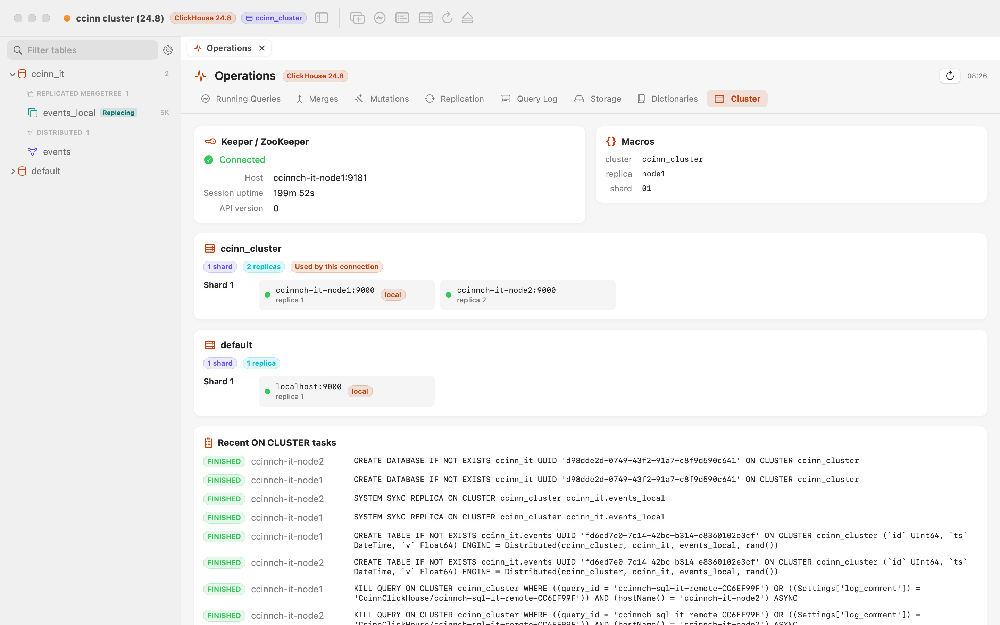
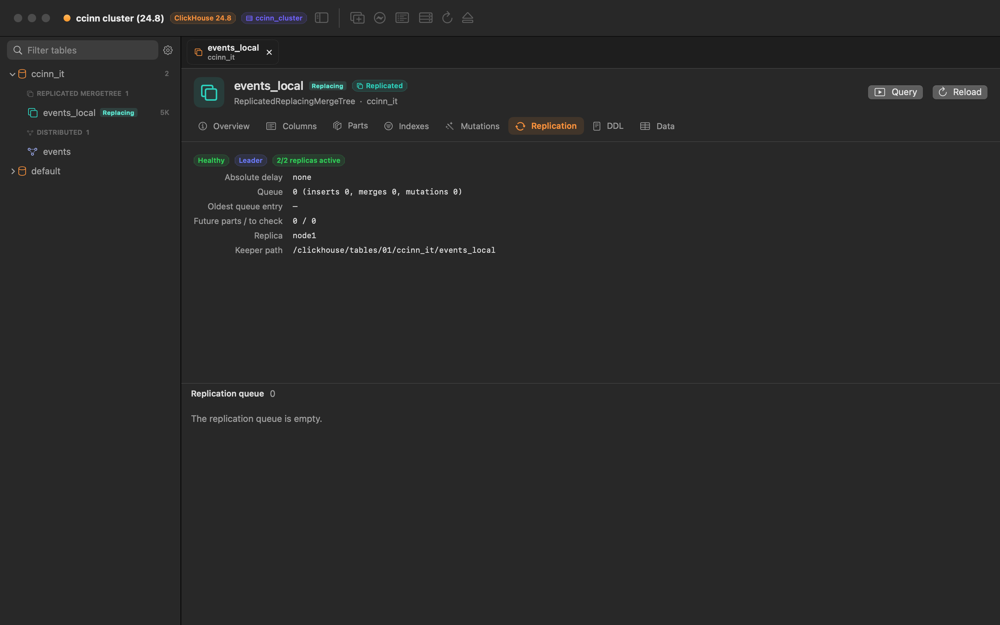

<p align="center">
  
</p>

<h1 align="center">CcinnClickHouse</h1>

<p align="center">
  <b>A fast, native macOS client built for ClickHouse.</b><br>
  See parts, compression and merges, keep replication and mutations healthy, find the slowest queries, and turn any query into a chart.
</p>

<p align="center">
  <a href="https://github.com/whiteCcinn/ccinnclickhouse/actions/workflows/ci.yml"></a>
  <a href="https://github.com/whiteCcinn/ccinnclickhouse/releases/latest"></a>
  
  
  
  <a href="LICENSE"></a>
</p>

<p align="center">
  English · <a href="README.zh-CN.md">简体中文</a>
</p>

<p align="center">
  
</p>

## Why CcinnClickHouse?

Generic SQL clients show ClickHouse as a flat list of tables and a query box. The things you actually need to run ClickHouse live in `system.parts`, `system.merges`, `system.mutations`, `system.replicas` and `system.query_log`, and in a lot of copy-pasting:

- which tables are Replacing, Summing or Aggregating MergeTrees, which are Distributed, and where they point,
- how many active parts a partition has, and how close it is to *Too many parts*,
- how well each column compresses, and what the TTLs, projections and skipping indexes are,
- which mutations are stuck, and which replicas lag,
- which queries are slow, memory-hungry or failing, and who runs them.

CcinnClickHouse puts all of that one click away, in a native SwiftUI/AppKit app that talks to ClickHouse over its HTTP(S) interface. There is no Electron, no JDBC, no bundled runtime and no telemetry.

## Features

- **Know what every table is.** Databases show their engine (Atomic, Replicated, MySQL, PostgreSQL, …). Tables are grouped by engine family, each with its own icon and colour: MergeTree, Replicated MergeTree, Distributed, materialized views, views, dictionaries, streaming (Kafka, RabbitMQ, NATS, S3Queue), integrations (MySQL, PostgreSQL, S3, URL, …), data lakes, Log and Memory. MergeTree variants get a badge (**Replacing / Summing / Aggregating / Collapsing / VCollapsing / Graphite / Coalescing**).
- **Table insights**
  - Engine, partition / sorting / primary / sampling keys, table and column **TTLs**, settings.
  - **Compression per column** (compressed, uncompressed, ratio) and a chart of the largest columns.
  - **Partitions and parts**: rows, size, compression, level, disk, TTL ranges, with **part-count warnings** against `parts_to_delay_insert` / `parts_to_throw_insert`.
  - **Projections** and **data-skipping indexes** with their sizes.
  - **Mutations** (with kill) and running **merges**.
  - **Replication** status and queue for Replicated tables, Distributed targets and pending inserts, materialized-view targets, dictionary status (with reload), DDL and a data preview.
- **SQL workbench**
  - Highlighting that understands ClickHouse (nested comments, heredocs, `{name:Type}` parameters).
  - Completion fed by the server: **functions with aggregate combinators** (`sumIf`, `uniqMerge`, `avgOrNullIf`), **settings** after `SET` / `SETTINGS` with their descriptions, formats, engines, table functions, data types, clusters, plus databases, tables, columns through aliases and CTEs.
  - Automatic `LIMIT` that knows `LIMIT … BY`, `SETTINGS` and `FORMAT`; **live progress** (rows and bytes read) while a query runs; **real cancellation**; errors underlined at their exact position.
  - `EXPLAIN` plan, plan with **indexes** or actions, **pipeline**, **estimate**, AST and syntax.
  - History, CSV / TSV / `INSERT` export (binary values keep their bytes).
- **Charts from any query.** A time column with numbers becomes a line chart, categories become bars, two numbers a scatter plot; switch between bar, line, area, scatter and pie, pick axes, series and aggregation. Large results are reduced to at most 2,000 points, off the main thread.
- **Operations**
  - **Running queries** across the whole cluster, with kill that reaches the node running the query.
  - Merges, mutations, replication health and the replication queue.
  - **Query-log analysis**: slowest, highest memory, failed, most expensive query patterns, and totals per user over a time window.
  - Disks and storage policies, dictionaries, and the **cluster topology** with Keeper status, macros and `ON CLUSTER` tasks.
- **Connectivity**
  - HTTP and **HTTPS** (with a private CA, or skip verification for tests), path prefixes for reverse proxies, **chproxy** and load balancers.
  - SSH tunnels through your system OpenSSH (agent, key or password).
  - **Read-only connections enforced by ClickHouse** (`readonly=1`, verified on the real request path when connecting), and optional confirmation before statements that change data or schema.
- **AI access through MCP.** A built-in Model Context Protocol server lets Claude Code, Codex and Claude Desktop explore and query the connections you opt in, read-only by default. See [MCP server](#mcp-server-let-ai-query-clickhouse).
- **Secure by default.** Passwords live in the macOS Keychain; nothing is collected or sent anywhere unless you enable AI access.

## Compatibility

| ClickHouse | Topology | Tested |
|---|---|---|
| 22.8, 23.8, 24.8, 25.8, 26.8 | single node | ✅ full integration suite on every release |
| 24.8 | 1 shard × 2 replicas, embedded Keeper, `ReplicatedMergeTree` + `Distributed`, `ON CLUSTER` | ✅ |
| 24.8 | behind **chproxy** 1.30 (load-balanced, rewrites query ids) | ✅ |
| 24.8 | HTTPS with a private CA | ✅ |
| 22.x – 26.x | other topologies, ClickHouse Keeper or ZooKeeper | expected to work |

CcinnClickHouse speaks the **HTTP(S) interface** (ports 8123 / 8443) with typed results (`TabSeparatedWithNamesAndTypes`). Queries against `system.*` tables are built from the columns each server version actually has, so missing columns become empty instead of errors; features that need privileges (`KILL`, `system.replicas`, `query_log`) degrade with an explanation. Users whose server profile is `readonly=1` work too. Runs on **macOS 14 Sonoma or later** (Apple silicon and Intel).

## Screenshots

| Partitions and parts with part counts | Compression per column, keys and TTL |
|---|---|
|  |  |
| **Charts generated from a query** | **Query-log analysis** |
|  |  |
| **Cluster topology, Keeper and ON CLUSTER tasks** | **Replication** |
|  |  |

## Installation

1. Download `CcinnClickHouse-<version>.dmg` (or the `.zip`) from the [latest release](https://github.com/whiteCcinn/ccinnclickhouse/releases/latest).
2. Open the disk image and drag **CcinnClickHouse** into **Applications**.
3. The app is ad-hoc signed but not notarized. The first time, right-click the app and choose **Open**, or run:

   ```bash
   xattr -dr com.apple.quarantine /Applications/CcinnClickHouse.app
   ```

Each release lists SHA-256 checksums in `SHA256SUMS.txt`.

## Quick start

1. Click **New Connection** and enter the host and HTTP port (default **8123**, or **8443** with **HTTPS**), user and password. Optionally add a default database, the cluster name (for cluster-wide views and kills), an SSH tunnel, or mark the connection read-only.
2. Press **Test**, then **Save & Connect**.
3. Expand a database in the sidebar and pick a table to see its parts, compression, mutations and replication. Or press **⌘T** for a SQL editor.

Useful shortcuts:

| Shortcut | Action |
|---|---|
| **⌘↩** | Run the selection or the current statement |
| **⇧⌘↩** | Run all statements |
| **⌘E** / **⇧⌘E** | Explain with indexes / explain pipeline |
| **⌘.** | Cancel the running statement |
| **⌃Space** | Show completions |
| **⌘/** | Comment or uncomment lines |
| **⌘T** | New query |
| **⌥⌘1** / **⌥⌘2** | Running queries / query log |
| **⇧⌘R** | Refresh databases |
| **⇧⌘D** | Disconnect |

## MCP server: let AI query ClickHouse

CcinnClickHouse has a built-in **Model Context Protocol** server. AI assistants such as **Claude Code**, **Codex**, **Claude Desktop** or Cursor can use it to explore your servers and run queries through your saved connections.

1. Open a connection in CcinnClickHouse and set **AI access (MCP)** to **Read-only** or **Read & write**. Connections are off by default.
2. Register the server. **Settings → MCP** shows these snippets with the right path, ready to copy:

   ```bash
   # Claude Code
   claude mcp add ccinnclickhouse -- /Applications/CcinnClickHouse.app/Contents/MacOS/CcinnClickHouse mcp
   ```

   ```toml
   # Codex (~/.codex/config.toml)
   [mcp_servers.ccinnclickhouse]
   command = "/Applications/CcinnClickHouse.app/Contents/MacOS/CcinnClickHouse"
   args = ["mcp"]
   ```

   ```json
   // Claude Desktop (claude_desktop_config.json) and other JSON-configured clients
   { "mcpServers": { "ccinnclickhouse": { "command": "/Applications/CcinnClickHouse.app/Contents/MacOS/CcinnClickHouse", "args": ["mcp"] } } }
   ```

3. Ask questions such as *"Which tables in `shop` are close to too many parts?"*, *"Are any mutations stuck?"* or *"What were the five slowest queries in the last hour, and who ran them?"*

**Tools**

| Group | Tools |
|---|---|
| Connections | `list_connections` |
| Schema | `list_databases`, `list_tables`, `describe_table` |
| Table insights | `get_parts`, `get_merges_and_mutations`, `get_replication`, `list_dictionaries` |
| Server | `get_running_queries`, `analyze_query_log`, `get_cluster`, `get_storage` |
| SQL | `run_query`, `explain_query`, and `execute_statement` (read & write connections only) |

`list_tables` reports each table's engine family and MergeTree variant; `describe_table` returns columns with compression, keys, TTLs, projections and skipping indexes; `get_parts` flags partitions that are close to `parts_to_delay_insert`.

**Safety**

- Passwords stay in the Keychain and are never shown to the AI.
- Only connections you enabled are visible.
- `run_query` accepts a single read-only statement (`SELECT`, `WITH`, `SHOW`, `DESCRIBE`, `EXISTS`, `EXPLAIN`). The app checks this with its own SQL lexer and also refuses functions that reach outside ClickHouse (`url`, `file`, `s3`, `remote`, `mysql`, `executable`, …), table functions outside a small allow-list and per-query `SETTINGS`.
- **ClickHouse enforces it too**: every request of a read-only connection carries `readonly=1`, and the connection checks `getSetting('readonly')` on the actual request path before it is used. Proxies such as **chproxy drop `readonly`**; read-only access through them is refused unless the ClickHouse user behind the proxy has a read-only settings profile (map the proxy user to such a user).
- Changing a connection's AI access in Settings applies to a running MCP server immediately.
- Results are capped at 1,000 rows (200 by default) and about 256 KB. Statements time out after 30 s by default (at most 120 s).
- Cancelling a request in the AI client stops the query on ClickHouse.
- `--read-only` caps every connection at read-only; `--profile <name>` picks the default connection.
- Every call is logged, with credentials redacted, to `~/Library/Application Support/CcinnClickHouse/mcp-audit.jsonl`.
- `CCINNCLICKHOUSE_PROFILE_DIR` relocates the saved connections, and `CCINNCLICKHOUSE_TEST_PASSWORD_<PROFILE-UUID>` supplies a password without the Keychain. **Both exist for automated tests only.**

## Building from source

Requirements: macOS 14+, Xcode 16 or later (Swift 6). No third-party dependencies.

```bash
git clone https://github.com/whiteCcinn/ccinnclickhouse.git
cd ccinnclickhouse
swift build                          # debug build
swift test --skip IntegrationTests   # unit tests
scripts/build-app.sh --open          # build dist/CcinnClickHouse.app and launch it
scripts/package-release.sh 1.0.0     # universal .app, .zip, .dmg and checksums in dist/
```

### Integration tests against real servers

Docker is required. Containers are named `ccinnch-it-*`, bound to `127.0.0.1` and memory-capped.

```bash
scripts/ch-up.sh 24.8 18101 && scripts/seed-demo.sh 18101
CCINNCH_IT_URL=http://127.0.0.1:18101 swift test --filter IntegrationTests
scripts/it-matrix.sh 22.8 23.8 24.8 25.8 26.8      # every version, one container at a time
scripts/ch-cluster-up.sh 24.8                       # two replicas + Keeper + chproxy
CCINNCH_IT_CLUSTER=1 CCINNCH_IT_URL=http://127.0.0.1:18111 swift test --filter ClusterIntegrationTests
scripts/ch-down.sh
```

## Architecture

```
CcinnClickHouse (SwiftUI app + `mcp` subcommand)
 └─ CcinnClickHouseKit  profiles & Keychain, SQL lexer/splitter/auto-limit/read-only guard/redactor, completion, charts, export, history, MCP
     └─ ClickHouseKit   transport protocol + URLSession, client, sessions, cancellation by query id, SSH, metadata, insights, operations
         └─ ClickHouseWire  type grammar, streaming TSV parser, exceptions, progress headers, quoting, gzip (no I/O)
```

- **Typed, streaming results.** Results arrive as `TabSeparatedWithNamesAndTypes`, ClickHouse's own text rendering with a header of column types, so every type renders exactly as in `clickhouse-client` (including types the app has never seen). The parser is linear, bounded per row and fuzz-tested, tells NULL from the string `\N`, keeps the raw bytes of binary values, and recognises exceptions that interrupt a result in every framing from 22.x to 26.x.
- **Cancellation that reaches the server.** Every query has its own `query_id` (and a `log_comment` marker for proxies that replace it). Cancelling aborts the request and runs `KILL QUERY` for exactly that query, retried on fresh connections behind load balancers and sent `ON CLUSTER` when needed.
- **Sessions that survive.** Editors use `session_id` sessions; the current database and `SET`s are tracked so an expired session is recreated transparently.
- **Concurrency safety.** Sessions are actors with generation tokens, the transport applies back-pressure, and the project builds in Swift 6 strict-concurrency mode. Sorting, chart preparation, completion and export run off the main thread.
- **One lexer for everything.** Highlighting, statement splitting, auto-limit, the read-only guard, redaction, error positions and completion share one ClickHouse tokenizer, so they always agree.

## The ccinn series

Native macOS database and storage tools that share the same design, speed and care:

| App | What it is |
|---|---|
| [**CcinnMongo**](https://github.com/whiteCcinn/ccinnmongo) | Native MongoDB client for every server from 2.6 to 8.x, with the legacy `OP_QUERY` and the modern `OP_MSG` protocols. |
| [**CcinnStarRocks**](https://github.com/whiteCcinn/ccinnstarrocks) | Native StarRocks client. Covers partitions, tablets and skew, async and sync materialized views, running tasks, and SQL with completion and charts. |
| [**CcinnRedis**](https://github.com/whiteCcinn/ccinnredis) | Native Redis client for Redis 2.8 → 8.x and Valkey, in standalone, Sentinel, Cluster and proxy deployments. |
| [**CcinnBucket**](https://github.com/whiteCcinn/ccinnbucket) | Object storage browser for Amazon S3, S3-compatible services and Alibaba Cloud OSS. |
| [**CcinnMysql**](https://github.com/whiteCcinn/ccinnmysql) | Native MySQL and MariaDB client with TLS, every authentication method, replication and InnoDB insights. |
| [**CcinnPsql**](https://github.com/whiteCcinn/ccinnpsql) | Native PostgreSQL client with its own protocol implementation, activity and locks, replication, vacuum and query statistics. |
| **CcinnClickHouse** *(this project)* | Native ClickHouse client. Covers engine families, parts and compression, merges and mutations, replication, the query log and clusters, and SQL with completion and charts. |

## Contributors

- [whiteCcinn](https://github.com/whiteCcinn)

<a href="https://github.com/whiteCcinn/ccinnclickhouse/graphs/contributors"></a>

## Star history

[](https://star-history.com/#whiteCcinn/ccinnclickhouse&Date)

## Contributing

Contributions are welcome! Please read [CONTRIBUTING.md](CONTRIBUTING.md), and report security issues privately as described in [SECURITY.md](SECURITY.md).

## License

[MIT](LICENSE) © 2026 whiteCcinn. ClickHouse is a trademark of ClickHouse, Inc.; this project is not affiliated with or endorsed by ClickHouse, Inc.
