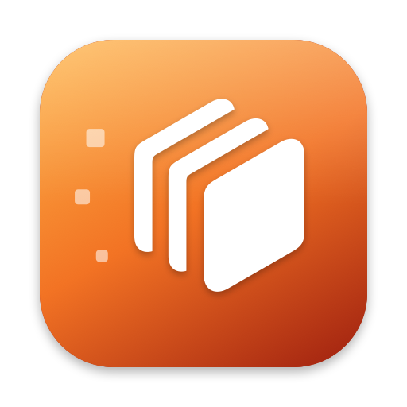
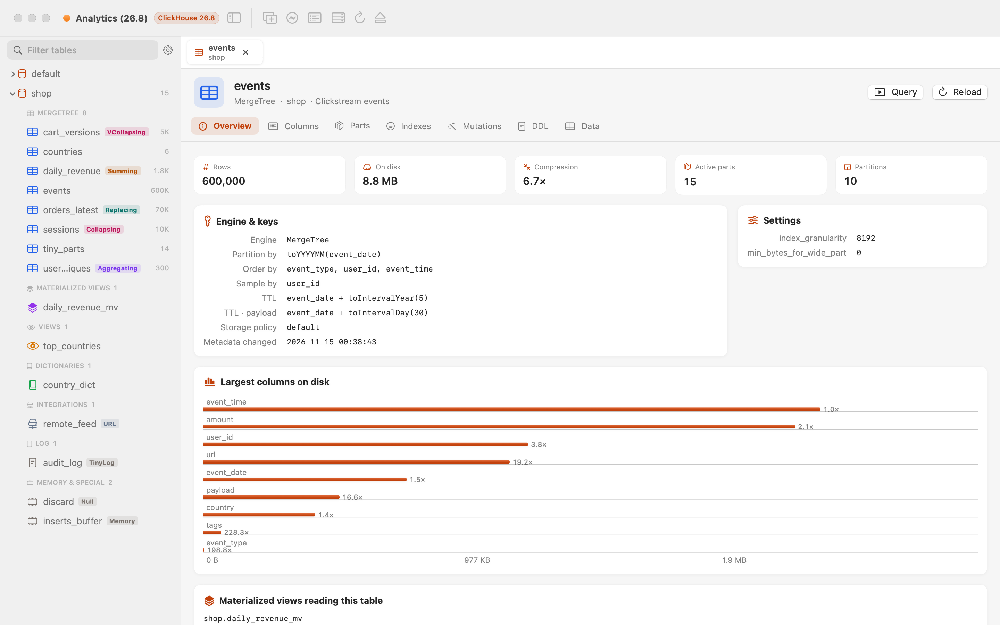
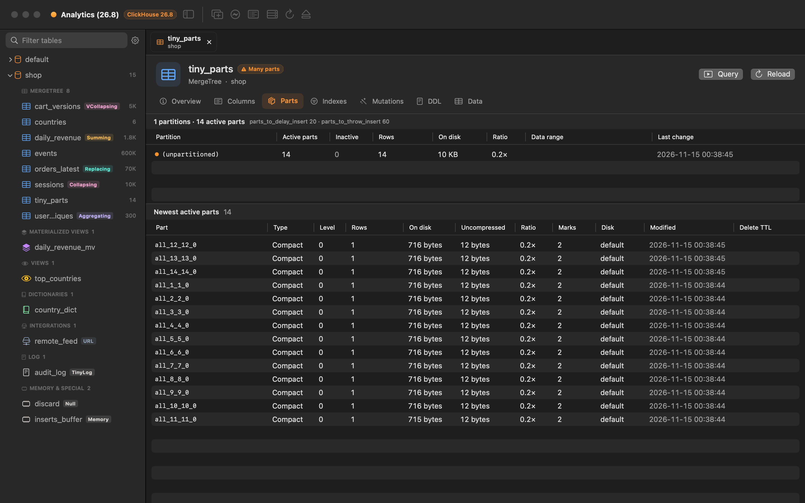
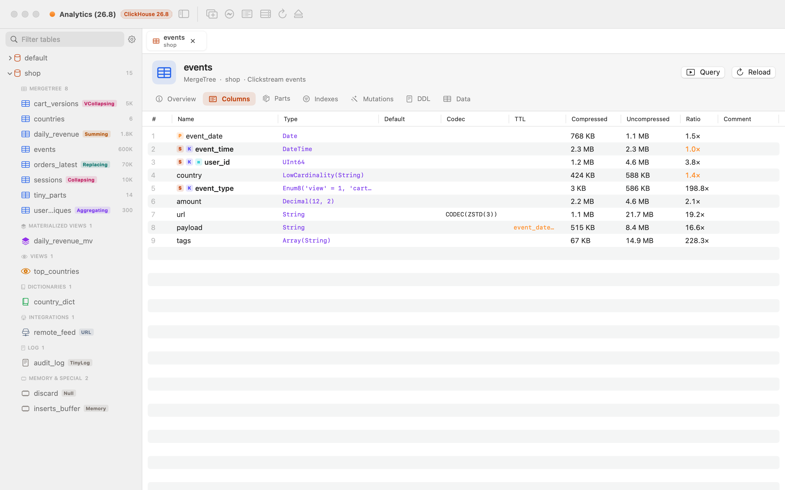
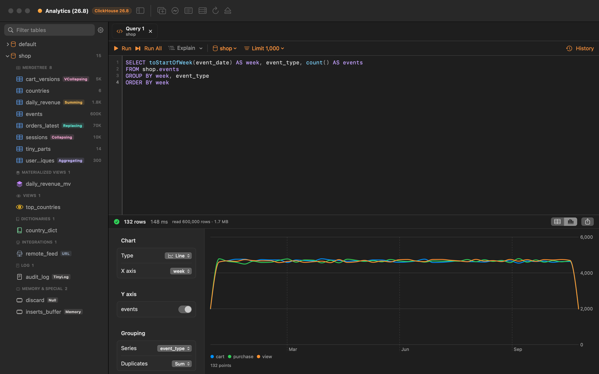
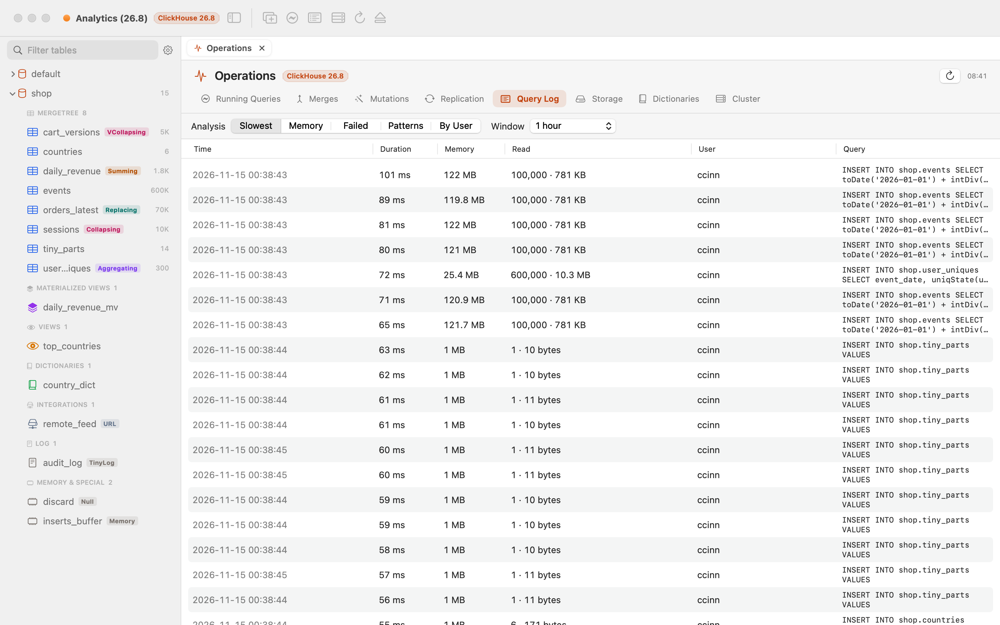
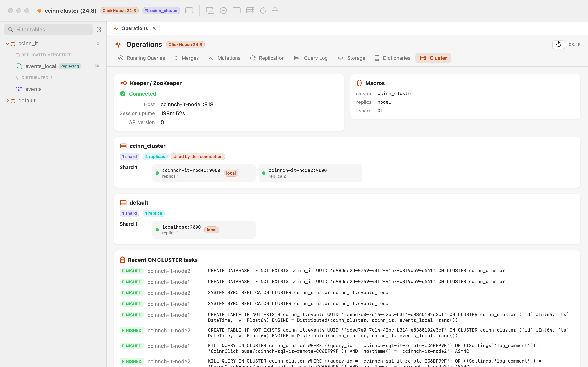
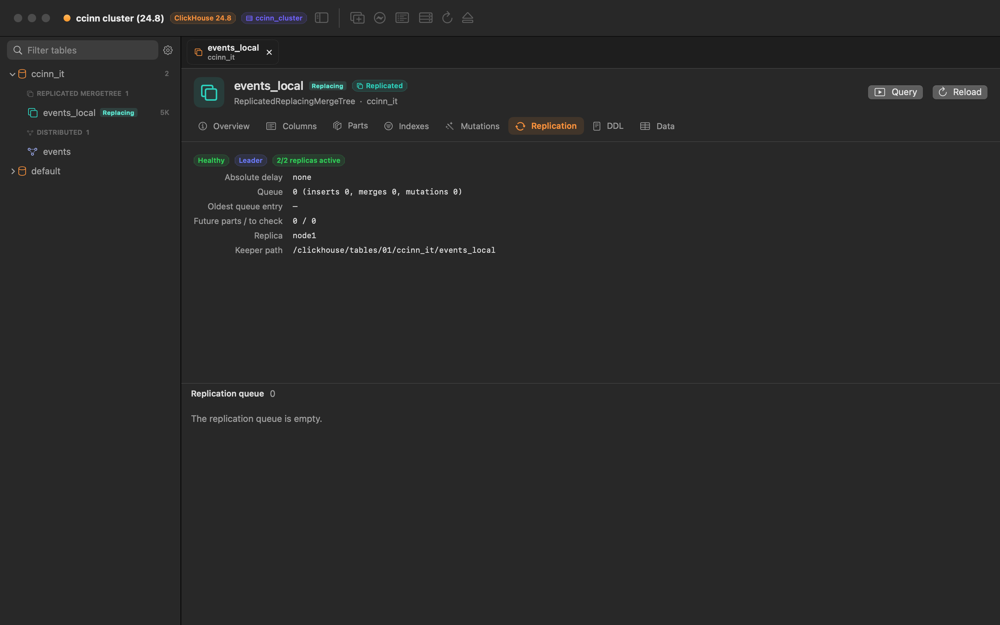

<p align="center">
  
</p>

<h1 align="center">CcinnClickHouse</h1>

<p align="center">
  <b>为 ClickHouse 打造的快速、原生 macOS 客户端。</b><br>
  一眼看清 Part、压缩与合并，守护复制与 Mutation 的健康，找出最慢的查询，并把任意查询一键变成图表。
</p>

<p align="center">
  <a href="https://github.com/whiteCcinn/ccinnclickhouse/actions/workflows/ci.yml"></a>
  <a href="https://github.com/whiteCcinn/ccinnclickhouse/releases/latest"></a>
  
  
  
  <a href="LICENSE"></a>
</p>

<p align="center">
  <a href="README.md">English</a> · 简体中文
</p>

<p align="center">
  
</p>

## 为什么选择 CcinnClickHouse？

通用 SQL 客户端只把 ClickHouse 当成一张扁平的表列表加一个查询框。真正运维 ClickHouse 需要的信息却散落在 `system.parts`、`system.merges`、`system.mutations`、`system.replicas`、`system.query_log` 里，只能靠大量复制粘贴：

- 哪些表是 Replacing、Summing、Aggregating MergeTree，哪些是 Distributed，它们指向哪里；
- 一个分区有多少活跃 Part，离 *Too many parts* 还有多远；
- 每一列的压缩效果如何，TTL、Projection、跳数索引是什么；
- 哪些 Mutation 卡住了，哪些副本落后了；
- 哪些查询慢、吃内存或失败，是谁在跑。

CcinnClickHouse 把这些都放在一次点击之内。它是原生 SwiftUI/AppKit 应用，通过 ClickHouse 的 HTTP(S) 接口通信。没有 Electron，没有 JDBC，不捆绑运行时，也没有任何遥测。

## 功能特性

- **一眼认出每张表。** 数据库显示其引擎（Atomic、Replicated、MySQL、PostgreSQL……）。表按引擎家族分组，每类都有专属图标与颜色：MergeTree、Replicated MergeTree、Distributed、物化视图、视图、字典、流式（Kafka、RabbitMQ、NATS、S3Queue）、集成（MySQL、PostgreSQL、S3、URL……）、数据湖、Log 与 Memory。MergeTree 变体带有徽章（**Replacing / Summing / Aggregating / Collapsing / VCollapsing / Graphite / Coalescing**）。
- **表洞察**
  - 引擎，分区 / 排序 / 主键 / 采样键，表级与列级 **TTL**，Settings。
  - **逐列压缩**（压缩后、压缩前、压缩比），以及最大列的图表。
  - **分区与 Part**：行数、大小、压缩、Level、磁盘、TTL 范围，并根据 `parts_to_delay_insert` / `parts_to_throw_insert` 给出 **Part 数量预警**。
  - **Projection** 与 **跳数索引** 及其大小。
  - **Mutation**（可 Kill）与正在进行的 **合并**。
  - Replicated 表的 **复制** 状态与队列，Distributed 的目标与待发送数据，物化视图的目标表，字典状态（可重新加载），DDL 与数据预览。
- **SQL 工作台**
  - 懂 ClickHouse 的语法高亮（嵌套注释、heredoc、`{name:Type}` 参数）。
  - 由服务器提供的补全：**函数与聚合组合器**（`sumIf`、`uniqMerge`、`avgOrNullIf`）、`SET` / `SETTINGS` 后的 **设置项**（带说明）、格式、引擎、表函数、数据类型、集群，以及数据库、表、通过别名与 CTE 的列。
  - 懂 `LIMIT … BY`、`SETTINGS`、`FORMAT` 的自动 `LIMIT`；查询运行时的 **实时进度**（已读行数与字节）；**真正的取消**；报错位置精确下划线。
  - `EXPLAIN` 计划、带 **索引** 或 actions 的计划、**Pipeline**、**Estimate**、AST 与 Syntax。
  - 历史记录，CSV / TSV / `INSERT` 导出（二进制值保留原始字节）。
- **任意查询生成图表。** 时间列加数值自动生成折线图，分类生成柱状图，两个数值生成散点图；可切换柱状、折线、面积、散点、饼图，选择坐标轴、系列与聚合方式。大结果集在后台缩减到最多 2,000 个点。
- **运维**
  - 全集群的 **运行中查询**，Kill 会送达真正运行该查询的节点。
  - 合并、Mutation、复制健康度与复制队列。
  - **query_log 分析**：最慢、最耗内存、失败、最昂贵的查询模式，以及按用户汇总，可选时间窗口。
  - 磁盘与存储策略、字典，以及 **集群拓扑**（Keeper 状态、宏、`ON CLUSTER` 任务）。
- **连接**
  - **多窗口**，每个窗口使用独立连接：文件 ▸ 新建窗口（⌘N），**用当前连接新建窗口**（⇧⌘N，也可点工具栏的“新建窗口”按钮），或在已保存的连接上选择**在新窗口中打开**。
  - HTTP 与 **HTTPS**（支持私有 CA，测试环境可跳过校验），反向代理路径前缀，**chproxy** 与负载均衡。
  - 通过系统 OpenSSH 的 SSH 隧道（agent、密钥或密码）。
  - **由 ClickHouse 强制执行的只读连接**（`readonly=1`，连接时在真实请求路径上验证），以及执行修改数据或结构的语句前可选的确认。
- **通过 MCP 让 AI 访问。** 内置 Model Context Protocol 服务，让 Claude Code、Codex、Claude Desktop 浏览并查询你授权的连接，默认只读。详见 [MCP 服务](#mcp-服务让-ai-查询-clickhouse)。
- **默认安全。** 密码保存在 macOS 钥匙串中；除非你开启 AI 访问，否则不会收集或发送任何数据。

## 兼容性

| ClickHouse | 拓扑 | 测试情况 |
|---|---|---|
| 22.8、23.8、24.8、25.8、26.8 | 单节点 | ✅ 每次发布运行完整集成测试 |
| 24.8 | 1 分片 × 2 副本，内嵌 Keeper，`ReplicatedMergeTree` + `Distributed`，`ON CLUSTER` | ✅ |
| 24.8 | 经由 **chproxy** 1.30（负载均衡，会改写 query id） | ✅ |
| 24.8 | 使用私有 CA 的 HTTPS | ✅ |
| 22.x – 26.x | 其他拓扑、ClickHouse Keeper 或 ZooKeeper | 预期可用 |

CcinnClickHouse 使用 **HTTP(S) 接口**（端口 8123 / 8443）与带类型的结果（`TabSeparatedWithNamesAndTypes`）。对 `system.*` 表的查询按服务器版本实际拥有的列构造，缺失的列显示为空而不是报错；需要权限的功能（`KILL`、`system.replicas`、`query_log`）会给出说明而不是直接失败。服务器端配置为 `readonly=1` 的用户同样可用。运行于 **macOS 14 Sonoma 及以上**（Apple 芯片与 Intel）。

## 截图

| 分区与 Part（含 Part 数量） | 逐列压缩、键与 TTL |
|---|---|
|  |  |
| **由查询生成的图表** | **query_log 分析** |
|  |  |
| **集群拓扑、Keeper 与 ON CLUSTER 任务** | **复制** |
|  |  |

## 安装

1. 从 [最新版本](https://github.com/whiteCcinn/ccinnclickhouse/releases/latest) 下载 `CcinnClickHouse-<version>.dmg`（或 `.zip`）。
2. 打开磁盘映像，把 **CcinnClickHouse** 拖入 **应用程序**。
3. 应用为 ad-hoc 签名，未经公证。首次打开时请右键点击应用并选择 **打开**，或执行：

   ```bash
   xattr -dr com.apple.quarantine /Applications/CcinnClickHouse.app
   ```

每个版本都在 `SHA256SUMS.txt` 中列出 SHA-256 校验和。

### 更新

选择 **CcinnClickHouse → 检查更新…（Check for Updates…）**。如果有新版本，CcinnClickHouse 会显示更新内容。**下载并打开（Download & Open）** 会把磁盘映像保存到“下载”文件夹，按该版本的 `SHA256SUMS.txt` 校验后再打开。退出 CcinnClickHouse，然后把新版本拖到 **应用程序** 文件夹即可。

CcinnClickHouse 每天也会在后台自动检查一次，可以在 **设置 → 通用 → 更新** 中关闭。检查只访问 GitHub 的公开 Releases API，也可以选择 **跳过此版本（Skip This Version）**。

项目主页、发布说明和问题反馈入口也在 **帮助** 菜单和“关于”窗口中。

## 快速开始

1. 点击 **New Connection**，填写主机与 HTTP 端口（默认 **8123**，开启 **HTTPS** 时为 **8443**）、用户名和密码。可选：默认数据库、集群名（用于全集群视图与 Kill）、SSH 隧道，或把连接标记为只读。
2. 点击 **Test**，再点 **Save & Connect**。
3. 在侧边栏展开数据库并选择一张表，查看它的 Part、压缩、Mutation 与复制情况；或按 **⌘T** 打开 SQL 编辑器。

常用快捷键：

| 快捷键 | 作用 |
|---|---|
| **⌘↩** | 运行选中内容或当前语句 |
| **⇧⌘↩** | 运行全部语句 |
| **⌘E** / **⇧⌘E** | 带索引的 Explain / Explain Pipeline |
| **⌘.** | 取消正在运行的语句 |
| **⌃Space** | 显示补全 |
| **⌘/** | 注释或取消注释 |
| **⌘T** | 新建查询 |
| **⌘N** | 新建窗口（连接另一台服务器，或同一台） |
| **⇧⌘N** | 用当前连接新建窗口 |
| **⌥⌘1** / **⌥⌘2** | 运行中查询 / 查询日志 |
| **⇧⌘R** | 刷新数据库 |
| **⇧⌘D** | 断开连接 |

## MCP 服务：让 AI 查询 ClickHouse

CcinnClickHouse 内置 **Model Context Protocol** 服务。**Claude Code**、**Codex**、**Claude Desktop**、Cursor 等 AI 助手可以借助它，通过你保存的连接浏览服务器并执行查询。

1. 在 CcinnClickHouse 中打开一个连接，把 **AI access (MCP)** 设为 **Read-only** 或 **Read & write**。所有连接默认关闭。
2. 注册服务。**设置 → MCP** 中已经准备好带正确路径、可直接复制的配置：

   ```bash
   # Claude Code
   claude mcp add ccinnclickhouse -- /Applications/CcinnClickHouse.app/Contents/MacOS/CcinnClickHouse mcp
   ```

   ```toml
   # Codex (~/.codex/config.toml)
   [mcp_servers.ccinnclickhouse]
   command = "/Applications/CcinnClickHouse.app/Contents/MacOS/CcinnClickHouse"
   args = ["mcp"]
   ```

   ```json
   // Claude Desktop（claude_desktop_config.json）及其他使用 JSON 配置的客户端
   { "mcpServers": { "ccinnclickhouse": { "command": "/Applications/CcinnClickHouse.app/Contents/MacOS/CcinnClickHouse", "args": ["mcp"] } } }
   ```

3. 试着提问：*"`shop` 里哪些表快要 too many parts 了？"*、*"有没有卡住的 Mutation？"*、*"过去一小时最慢的五条查询是什么，是谁跑的？"*

**工具**

| 分组 | 工具 |
|---|---|
| 连接 | `list_connections` |
| 库表结构 | `list_databases`、`list_tables`、`describe_table` |
| 表洞察 | `get_parts`、`get_merges_and_mutations`、`get_replication`、`list_dictionaries` |
| 服务器 | `get_running_queries`、`analyze_query_log`、`get_cluster`、`get_storage` |
| SQL | `run_query`、`explain_query`，以及 `execute_statement`（仅限读写连接） |

`list_tables` 返回每张表的引擎家族与 MergeTree 变体；`describe_table` 返回带压缩信息的列、键、TTL、Projection 与跳数索引；`get_parts` 标出接近 `parts_to_delay_insert` 的分区。

**安全**

- 密码留在钥匙串中，绝不会展示给 AI。
- 只有你启用的连接可见。
- `run_query` 只接受单条只读语句（`SELECT`、`WITH`、`SHOW`、`DESCRIBE`、`EXISTS`、`EXPLAIN`）。应用用自己的 SQL 词法分析器做检查，并拒绝访问 ClickHouse 外部的函数（`url`、`file`、`s3`、`remote`、`mysql`、`executable` 等）、白名单以外的表函数以及查询级 `SETTINGS`。
- **ClickHouse 也会强制执行**：只读连接的每个请求都带有 `readonly=1`，并且连接在使用前会在真实请求路径上检查 `getSetting('readonly')`。**chproxy 等代理会丢弃 `readonly`**；经由这类代理的只读访问会被拒绝，除非代理背后的 ClickHouse 用户本身使用只读设置配置（把代理用户映射到这样的用户）。
- 在设置中修改连接的 AI 访问权限，会立即作用于正在运行的 MCP 服务。
- 每次工具调用都是独立的无状态请求：某次调用中的 `SET`、`USE` 或临时表不会带入下一次调用。

**推荐做法：为 AI 使用专用的只读 ClickHouse 用户。** 若要真正隔离，请为 AI 访问创建独立的 ClickHouse 用户，其*设置配置（settings profile）*为只读，且只授予 `SELECT` 权限——不要授予 `SOURCES`、`URL`、`FILE`、`REMOTE`、`S3` 等权限。这样 ClickHouse 会自行强制只读（经由 chproxy 也同样有效），并拒绝访问服务器外部的表函数，不依赖应用本身。设置 → MCP 中提供同样的 SQL 并可一键复制；测试连接时会提示"由该用户的服务器配置强制只读"：

```sql
CREATE SETTINGS PROFILE IF NOT EXISTS ai_readonly SETTINGS readonly = 1;
CREATE USER IF NOT EXISTS ai_reader IDENTIFIED WITH sha256_password BY 'choose-a-password' SETTINGS PROFILE 'ai_readonly';
GRANT SELECT ON analytics.* TO ai_reader;
-- Grant nothing else: without SOURCES grants, url(), file(), s3(), remote() … stay denied.
```
- 结果最多 1,000 行（默认 200 行）、约 256 KB。语句默认 30 秒超时（最长 120 秒）。
- 在 AI 客户端中取消请求会停止 ClickHouse 上的查询。
- `--read-only` 把所有连接限制为只读；`--profile <name>` 指定默认连接。
- 每次调用都会记录到 `~/Library/Application Support/CcinnClickHouse/mcp-audit.jsonl`，凭据已脱敏。
- `CCINNCLICKHOUSE_PROFILE_DIR` 可更改保存连接的位置，`CCINNCLICKHOUSE_TEST_PASSWORD_<PROFILE-UUID>` 可绕过钥匙串提供密码。**两者仅用于自动化测试。**

## 从源码构建

要求：macOS 14+，Xcode 16 或更高版本（Swift 6）。无任何第三方依赖。

```bash
git clone https://github.com/whiteCcinn/ccinnclickhouse.git
cd ccinnclickhouse
swift build                          # 调试构建
swift test --skip IntegrationTests   # 单元测试
scripts/build-app.sh --open          # 构建 dist/CcinnClickHouse.app 并启动
scripts/package-release.sh 1.0.0     # 通用架构 .app、.zip、.dmg 及校验和，输出到 dist/
```

### 针对真实服务器的集成测试

需要 Docker。容器名为 `ccinnch-it-*`，只绑定 `127.0.0.1` 并限制内存。

```bash
scripts/ch-up.sh 24.8 18101 && scripts/seed-demo.sh 18101
CCINNCH_IT_URL=http://127.0.0.1:18101 swift test --filter IntegrationTests
scripts/it-matrix.sh 22.8 23.8 24.8 25.8 26.8      # 逐个版本运行，每次只起一个容器
scripts/ch-cluster-up.sh 24.8                       # 两个副本 + Keeper + chproxy
CCINNCH_IT_CLUSTER=1 CCINNCH_IT_URL=http://127.0.0.1:18111 swift test --filter ClusterIntegrationTests
scripts/ch-down.sh
```

## 架构

```
CcinnClickHouse（SwiftUI 应用 + `mcp` 子命令）
 └─ CcinnClickHouseKit  连接配置与钥匙串、SQL 词法/拆分/自动 LIMIT/只读守卫/脱敏、补全、图表、导出、历史、MCP
     └─ ClickHouseKit   传输协议 + URLSession、客户端、会话、按 query id 取消、SSH、元数据、洞察、运维
         └─ ClickHouseWire  类型语法、流式 TSV 解析、异常、进度头、转义、gzip（无 I/O）
```

- **带类型的流式结果。** 结果以 `TabSeparatedWithNamesAndTypes` 返回：这是 ClickHouse 自己的文本渲染，外加一行列类型，因此每种类型都与 `clickhouse-client` 显示完全一致（包括应用从未见过的类型）。解析器线性、单行有界、经过模糊测试，能区分 NULL 与字符串 `\N`，保留二进制值的原始字节，并能识别 22.x 到 26.x 各种格式下中途打断结果的异常。
- **能送达服务器的取消。** 每个查询都有自己的 `query_id`（以及为会改写 id 的代理准备的 `log_comment` 标记）。取消会中止请求并对该查询执行 `KILL QUERY`；在负载均衡之后会换新连接重试，必要时使用 `ON CLUSTER`。
- **不会丢失的会话。** 编辑器使用 `session_id` 会话；当前数据库与 `SET` 会被记录，会话过期时自动透明重建。
- **并发安全。** 会话是带代号令牌的 actor，传输层有背压，项目在 Swift 6 严格并发模式下构建。排序、图表准备、补全与导出都在主线程之外运行。
- **一个词法分析器贯穿始终。** 高亮、语句拆分、自动 LIMIT、只读守卫、脱敏、报错定位与补全共用同一个 ClickHouse 分词器，结果始终一致。

## ccinn 系列

同样注重设计、速度与细节的原生 macOS 数据工具：

| 应用 | 简介 |
|---|---|
| [**CcinnMongo**](https://github.com/whiteCcinn/ccinnmongo) | 原生 MongoDB 客户端，支持 2.6 到 8.x 的所有版本，同时支持旧版 `OP_QUERY` 与新版 `OP_MSG` 协议。 |
| [**CcinnStarRocks**](https://github.com/whiteCcinn/ccinnstarrocks) | 原生 StarRocks 客户端，涵盖分区、Tablet 与倾斜分析、异步/同步物化视图、运行中任务，以及带补全和图表的 SQL。 |
| [**CcinnRedis**](https://github.com/whiteCcinn/ccinnredis) | 原生 Redis 客户端，支持 Redis 2.8 → 8.x 与 Valkey，覆盖单机、Sentinel、Cluster 与代理部署。 |
| [**CcinnBucket**](https://github.com/whiteCcinn/ccinnbucket) | 对象存储浏览器，支持 Amazon S3、S3 兼容服务与阿里云 OSS。 |
| [**CcinnMysql**](https://github.com/whiteCcinn/ccinnmysql) | 原生 MySQL 与 MariaDB 客户端，支持 TLS 与全部认证方式，提供复制与 InnoDB 洞察。 |
| [**CcinnPsql**](https://github.com/whiteCcinn/ccinnpsql) | 原生 PostgreSQL 客户端，自研协议实现，提供活动与锁、复制、Vacuum 与查询统计。 |
| **CcinnClickHouse** *（本项目）* | 原生 ClickHouse 客户端，涵盖引擎家族、Part 与压缩、合并与 Mutation、复制、查询日志与集群，以及带补全和图表的 SQL。 |

## 贡献者

- [whiteCcinn](https://github.com/whiteCcinn)

<a href="https://github.com/whiteCcinn/ccinnclickhouse/graphs/contributors"></a>

## Star 趋势

[](https://star-history.com/#whiteCcinn/ccinnclickhouse&Date)

## 参与贡献

欢迎贡献！请阅读 [CONTRIBUTING.md](CONTRIBUTING.md)，安全问题请按 [SECURITY.md](SECURITY.md) 中的方式私下报告。

## 许可证

[MIT](LICENSE) © 2026 whiteCcinn。ClickHouse 是 ClickHouse, Inc. 的商标；本项目与 ClickHouse, Inc. 无关联，也未获其认可。
